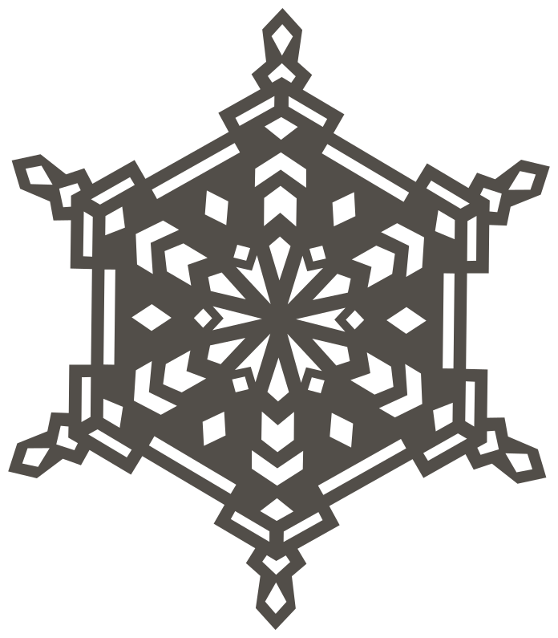

# flocons

[](https://marcbernot.github.io/flocons/notebooks/index.html?path=snowflake.ipynb)



`preview.webp` is a photo of a printed paper snowflake. The notebook
[`notebooks/snowflake.ipynb`](notebooks/snowflake.ipynb) turns it into the SVG on the right:
one even-odd path, straight segments only, sharp corners, exactly D6-symmetric.

How: the ink is one connected component with 72 holes. Each component is fitted with a
polygon (Douglas-Peucker for the corners, then every edge refitted as a straight line and every
corner put at the intersection of its two lines; tested first on a synthetic dart, where it finds
the corners to 0.4 px against 2.7 px for Douglas-Peucker alone). The flake's symmetry (6
rotations, 6 mirrors) is measured on the image; the 12 copies of each kind of hole are folded onto
one, the vertices most copies agree on are kept, and the result is copied back around. The model
covers the scan with an IoU of 0.962, as close as the scan is to its own symmetric average
(0.964).

The image ships in the package (`src/flocons/data/preview.webp`), so the notebook also runs in
the browser (badge above).

## Run locally

```bash
pixi run lab        # installs the environment on first run
pixi task list -s   # the other tasks, per environment
```

The notebooks in `notebooks/` run unchanged locally and in the browser (JupyterLite):
`pixi run build-lite && pixi run serve-lite` serves the site on <http://localhost:8000>.
